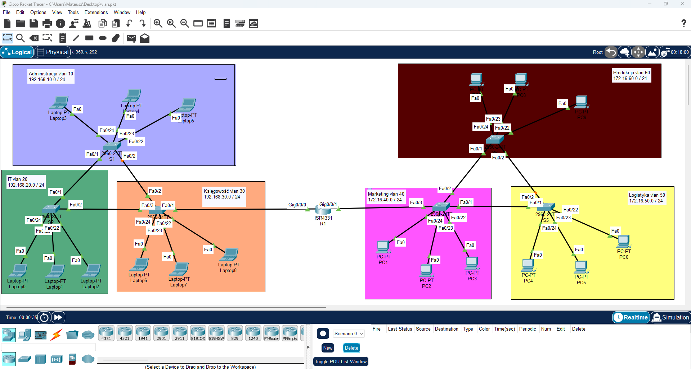

# Enterprise VLAN Network Topology & Inter-VLAN Routing

## 📌 Opis Projektu
Projekt przedstawia segmentację sieci korporacyjnej na podstawie wydziałów firmy z wykorzystaniem technologii **VLAN** oraz routingu **Router-on-a-Stick** na routerze Cisco ISR4331.

Każdy dział znajduje się w osobnej podsieci IP i osobnym VLAN-ie, co zapewnia odpowiedni poziom bezpieczeństwa oraz optymalizację ruchu rozgłoszeniowego (broadcast).

---

## 🗺️ Schemat Sieci (Topologia)


---

## 🌐 Podział na VLAN-y i Adresacja IP

| VLAN ID | Nazwa Działu | Podsieć IP | Bramka (Gateway) | Liczba Urządzeń |
|:-------:|:------------|:-----------|:-----------------|:---------------:|
| **10**  | Administracja | `192.168.10.0/24` | `192.168.10.1` | Laptop3 - Laptop5 |
| **20**  | IT            | `192.168.20.0/24` | `192.168.20.1` | Laptop0 - Laptop2 |
| **30**  | Księgowość   | `192.168.30.0/24` | `192.168.30.1` | Laptop6 - Laptop8 |
| **40**  | Marketing     | `172.16.40.0/24`  | `172.16.40.1`  | PC1 - PC3 |
| **50**  | Logistyka     | `172.16.50.0/24`  | `172.16.50.1`  | PC4 - PC6 |
| **60**  | Produkcja     | `172.16.60.0/24`  | `172.16.60.1`  | PC7 - PC9 |

---

## 🛠️ Zastosowane Technologie i Protokoły
- **VLAN (Virtual Local Area Network)** – segmentacja warstwy 2 ISO/OSI.
- **802.1Q Trunking** – tagowanie ramek i przesyłanie ruchu wielu VLAN-ów magistralami trunk między przełącznikami a routerem.
- **Inter-VLAN Routing (Router-on-a-Stick)** – routing pomiędzy podsieciami z wykorzystaniem podinterfejsów (subinterfaces) na routerze Cisco ISR4331.
- **Spanning Tree Protocol (STP)** – ochrona przed pętlami w Warstwie 2.

---

## 📁 Pliki w Repozytorium
- `vlan.pkt` – Plik projektu Cisco Packet Tracer.
- `configs/` – Katalog zawierający pełne pliki konfiguracji (`running-config`) dla przełączników (S1–S6) oraz routera (R1).

---

## ⚙️ Kluczowa Konfiguracja (Przykład)

### 1. Konfiguracja Trunking na Przełączniku
```cisconetworking
interface FastEthernet0/1
 switchport mode trunk
 switchport trunk allowed vlan 10,20,30,40,50,60
